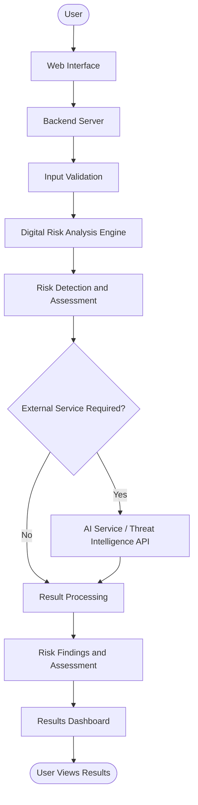

# 🛡️ DigitalSentinel – Digital Risk Monitoring Platform

## Overview

DigitalSentinel is a web-based digital risk monitoring platform designed to help users identify, analyze, and understand potential digital risks through an intuitive and user-friendly interface. It aims to simplify digital risk assessment by processing supported inputs and presenting relevant findings in an organized format.

## 🎯 Objectives

- Identify and analyze potential digital risks.
- Provide a centralized platform for digital risk assessment.
- Present risk findings in a clear and understandable format.
- Offer an intuitive dashboard for accessing analysis features.
- Support integration with automated analysis and external intelligence services where applicable.

## ✨ Features

- **Interactive Dashboard:** Access available platform features from a centralized interface.
- **Digital Risk Analysis:** Analyze supported inputs using the application's implemented detection logic.
- **Risk Assessment:** Organize identified findings to help users understand potential risks.
- **Results Visualization:** Present analysis results through a clear user interface.
- **Easy Navigation:** Move between the available sections of the application.
- **Modular Design:** Support easier maintenance and future feature development.
- **Secure Configuration:** Keep API keys and sensitive credentials in environment variables.

*Feature availability depends on the functionality implemented in the current version of the application.*

## 🏗️ System Architecture

DigitalSentinel follows a layered architecture in which the user interface communicates with the backend application. The backend validates requests, coordinates risk analysis, optionally integrates external services, and returns processed results to the dashboard.



### Architecture Components

1. **User:** Submits supported information and views the analysis results.
2. **Web Interface:** Provides the dashboard, input forms, navigation, and result displays.
3. **Backend Server:** Receives user requests and coordinates the application's processing logic.
4. **Input Validation:** Checks submitted data before passing it to the analysis engine.
5. **Digital Risk Analysis Engine:** Applies the detection methods and analysis rules implemented in the application.
6. **Risk Detection and Assessment:** Evaluates the available data to identify potential risks and relevant indicators.
7. **External Services:** Supplies additional analysis or threat-intelligence information when external AI services or APIs are configured.
8. **Result Processing:** Organizes the findings into a structured response.
9. **Results Dashboard:** Displays the processed results to the user.

### Data Flow

1. The user submits information through the web interface.
2. The backend server receives the request and validates the submitted data.
3. The digital risk analysis engine processes the validated input.
4. The application uses external AI or threat-intelligence services if required and configured.
5. The available findings are processed into a structured response.
6. The results dashboard presents the findings to the user.

*Note: This architecture illustrates the intended processing flow. Remove or modify any components that are not part of the actual implementation.*

## 🛠️ Technologies Used

Update the following list to reflect the technologies actually used in your codebase.

- **Frontend:** HTML, CSS, JavaScript
- **Backend:** Python and Flask, if used
- **Analysis:** Custom analysis logic and integrated AI or external APIs, where applicable
- **Configuration:** Environment variables
- **Version Control:** Git and GitHub
- **Deployment:** A hosting platform compatible with the application

## ⚙️ Installation and Setup

### Prerequisites

- Python 3.x, if the application uses Python
- Git
- Visual Studio Code or another code editor

### 1. Clone the Repository

```bash
git clone https://github.com/YOUR_USERNAME/DigitalSentinel.git
cd DigitalSentinel
```

Replace `YOUR_USERNAME` and the repository name with your actual GitHub details.

### 2. Create a Virtual Environment

For a Python-based application:

```bash
python -m venv venv
```

Activate it on Windows:

```bash
venv\Scripts\activate
```

### 3. Install Dependencies

If your repository contains a `requirements.txt` file:

```bash
pip install -r requirements.txt
```

### 4. Configure Environment Variables

Create a `.env` file in the project root and add the environment variables required by your application.

```env
# Add your required environment variables here
# Never commit real API keys or secrets
```

Use the actual variable names expected by your code. Do not share API keys publicly.

### 5. Run the Application

For a Flask application whose entry point is `app.py`:

```bash
python app.py
```

Open the local URL displayed in the terminal, commonly:

`http://127.0.0.1:5000`

Follow the actual run commands for your application if it uses a different framework or entry point.

## 🌐 Deployment

DigitalSentinel can be deployed to a hosting platform compatible with its framework and dependencies.

1. Push the application code to GitHub.
2. Connect the GitHub repository to your chosen hosting provider.
3. Configure the required environment variables in the hosting dashboard.
4. Set the appropriate build and start commands.
5. Deploy the application.
6. Test the deployed website and verify that its features work correctly.

**Deployment considerations:**

- Keep API keys in the hosting provider's environment settings.
- Confirm that the selected hosting plan supports the application's dependencies.
- Check free-tier limits, sleep behavior, and service-expiration policies.
- Never assume a temporary deployment will remain available indefinitely.

## 🔐 Security Considerations

- Store API keys and secrets in environment variables.
- Add `.env`, virtual environments, and generated sensitive files to `.gitignore`.
- Validate and sanitize user inputs.
- Handle errors without exposing internal details or credentials.
- Use HTTPS for public deployments.
- Protect any stored user information.
- Apply appropriate authentication and access controls if the application supports user accounts.
- Treat automated risk findings as indicators rather than guarantees of security.

## 🔮 Future Enhancements

- Real-time digital risk monitoring.
- AI-assisted risk detection and explanations.
- Risk scoring and severity classification.
- Historical reports and trend analysis.
- Interactive charts and analytics.
- Automated notifications for detected risks.
- Integration with additional threat-intelligence sources.
- Improved authentication and access control.
- Exportable risk assessment reports.

## 🤝 Contributing

Contributions and suggestions are welcome.

1. Fork the repository.
2. Create a new feature branch.
3. Implement your changes.
4. Test the updated functionality.
5. Submit a pull request describing your improvements.

## 📄 License

Add a `LICENSE` file to specify how others may use, modify, and distribute this project. Choose a license appropriate for your intended use.